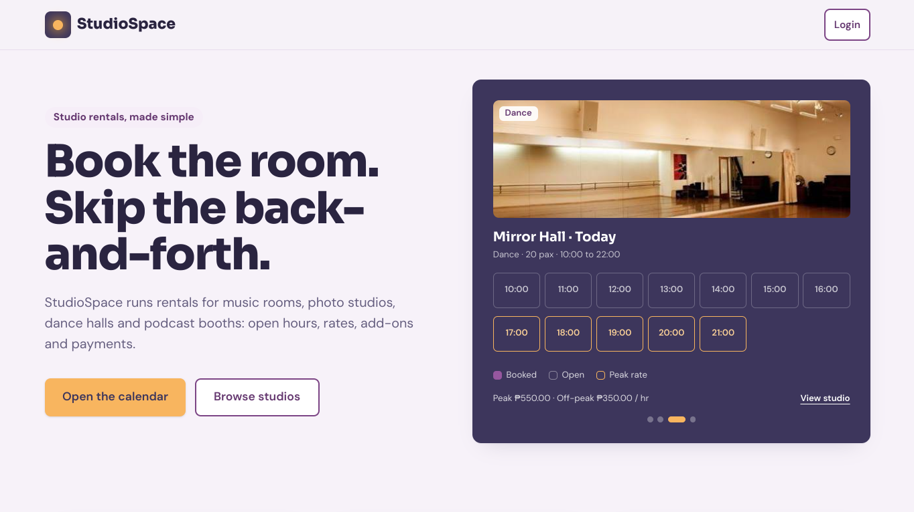
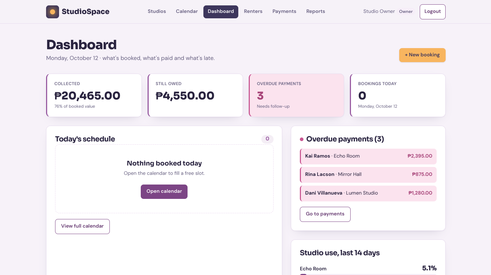
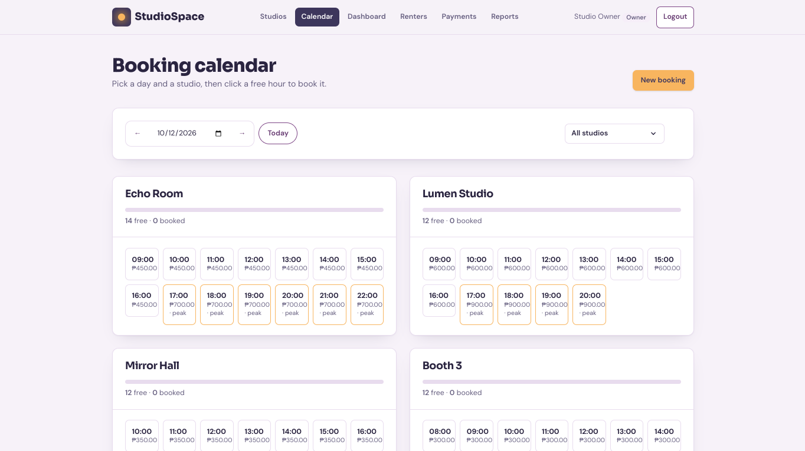
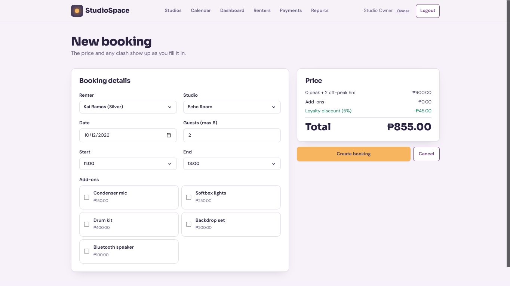
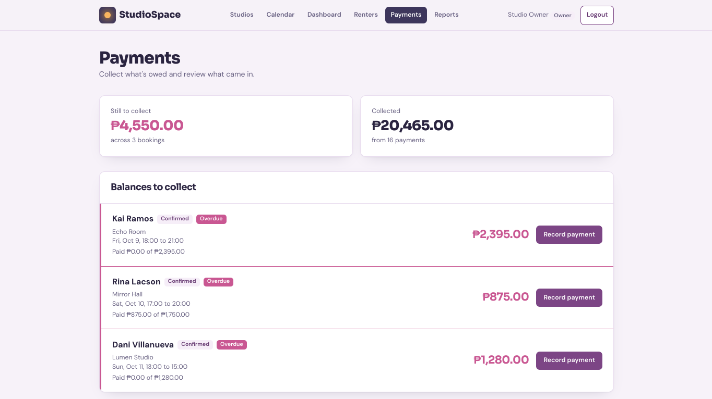
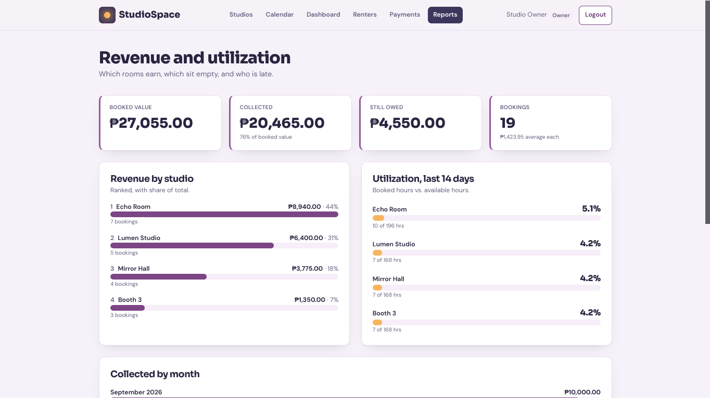
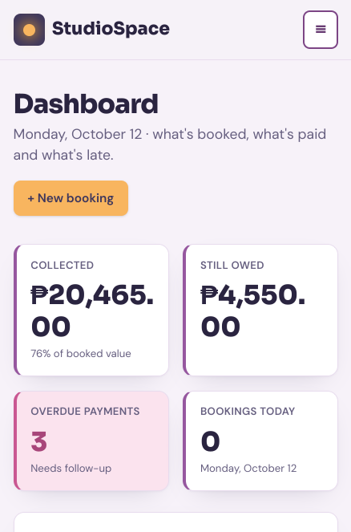

# StudioSpace: A Web-Based Studio Booking, Availability, and Rental Payment Management System

**Course:** CTADWEBL, Advanced Web Programming (A.Y. 2026-2027)
**Group:** [Group name / Section]
**Repository:** [GitHub link]

## Group Members

| Member                    | Role                        | Main contributions                                                  |
| ------------------------- | --------------------------- | ------------------------------------------------------------------- |
| Gutierrez, Rafael A.      | Backend and Database        | [Edit to match commits: Express API, Mongoose models, seed scripts] |
| Bitun, Andrew D.          | Frontend Functionality      | [Edit to match commits: React Router, axios, forms, hooks]          |
| Datu, Milcah V.           | UI Design and Documentation | [Edit to match commits: Tailwind theme, pages, README]              |
| Bautista, Adrienne Jey O. | UI Design and Documentation | [Edit to match commits: components, responsive layout, testing]     |

## Concept

Studio owners who rent out music rooms, photo studios, dance halls and podcast booths often double-book rooms, lose track of rental payments, and can't see which rooms earn the most. **StudioSpace** lets customers browse studios and book hours, and lets the studio owner manage rooms, confirm bookings, collect payments, and read revenue and utilization reports.

## What the Application Does

There are two roles:

- **Customer:** registers and logs in, browses studios, checks hour-by-hour availability, books a studio with optional add-ons, sees a live price before saving, and edits or cancels their own bookings.
- **Owner:** manages studios, add-ons and renters, confirms and completes bookings, records payments, and views the dashboard and reports.

## Data It Processes

| Data                | What is stored                                                      | How it is used                                                    |
| ------------------- | ------------------------------------------------------------------- | ----------------------------------------------------------------- |
| Users               | name, email, password, role                                         | Login and role-based access                                       |
| Renters             | name, email, phone                                                  | Customer profile; loyalty tier is derived from completed bookings |
| Studios             | name, type, capacity, peak and off-peak rates, open and close hours | Availability and pricing                                          |
| Equipment (add-ons) | name, fee, units owned                                              | Add-ons; units are checked for clashes                            |
| Bookings            | renter, studio, date, hours, guests, add-ons, status                | Pricing, double-booking checks, status flow                       |
| Payments            | booking, amount, method, date                                       | Balance due, overdue flags, revenue                               |

Relationships: a Booking belongs to one Renter and one Studio and can include many Equipment items. A Payment belongs to one Booking. Registering a customer creates a User and a Renter profile with the same ID.

## Business Logic (Data Processing)

- **Availability and double-booking prevention:** a booking is rejected if the studio, or an add-on's available units, is taken for any overlapping hour.
- **Pricing:** hours x rate (hours from 17:00 are peak) + add-ons - loyalty discount.
- **Loyalty tiers:** Silver (2+ completed bookings, 5% off) and Gold (4+, 10% off).
- **Status flow:** pending -> confirmed -> paid -> completed. Pending or confirmed bookings can be cancelled. "Paid" requires a zero balance. Cancelling requires no recorded payments.
- **Payments:** only on confirmed, paid or completed bookings, and never more than the balance due. A full payment moves a confirmed booking to paid.
- **Overdue flag:** a billable booking whose date has passed with a balance still due.
- **Reports:** utilization (booked vs open hours over the last 14 days), revenue per studio, and revenue per month.

## Screenshots

Add the images to `docs/screenshots/` and keep these links.

| Page                        | Screenshot                                       |
| --------------------------- | ------------------------------------------------ |
| Landing                     |          |
| Dashboard (owner)           |      |
| Booking calendar            |        |
| New booking with live price |  |
| Payments                    |        |
| Reports                     |          |
| Mobile view (375px)         |            |

## Tech Stack

React (Vite) + TypeScript, Tailwind CSS, React Router, React Hook Form + Zod, axios, Node.js + Express, MongoDB Atlas + Mongoose, Git and GitHub.

## Project Structure

```
client/                 React app
  src/pages/            Route pages
  src/components/       Shared components
  src/hooks/            Custom hooks
  src/lib/              axios instance, schemas, helpers
server/                 Express API
  src/models/           Mongoose models
  src/routes/           express.Router() route files
  src/middleware/       Logger, error handler, 404, role checks
  src/lib/              Booking and pricing rules
  src/app.js            Configuration and mounting only
```

## Setup Instructions

**Requirements:** Node.js 18 or newer, and a free MongoDB Atlas cluster.

1. Create an Atlas cluster, add a database user, and allow your IP under **Network Access**.
2. Clone the repository.
3. Set up the server (Terminal 1):
   ```bash
   cd server
   cp .env.example .env      # then fill in the values below
   npm install
   node src/seedOwner.js     # creates the owner account once
   npm run dev               # API on http://localhost:5000
   ```
4. Set up the client (Terminal 2):
   ```bash
   cd client
   cp .env.example .env
   npm install
   npm run dev               # App on http://localhost:5173
   ```
5. Open http://localhost:5173. Sample studios, renters and bookings are added automatically the first time the server starts on an empty database.

### Environment Variables

`.env` files are not committed. Each folder has a committed `.env.example`.

| File        | Variable                                      | Purpose                                  | Example                                                           |
| ----------- | --------------------------------------------- | ---------------------------------------- | ----------------------------------------------------------------- |
| server/.env | `PORT`                                        | API port                                 | `5000`                                                            |
| server/.env | `MONGO_URI`                                   | MongoDB Atlas connection string          | `mongodb+srv://<user>:<password>@cluster.mongodb.net/studiospace` |
| server/.env | `CLIENT_URL`                                  | Allowed origin for CORS                  | `http://localhost:5173`                                           |
| server/.env | `OWNER_NAME`, `OWNER_EMAIL`, `OWNER_PASSWORD` | Owner account created by the seed script | `Studio Owner`, `owner@example.com`, `<choose a password>`        |
| client/.env | `VITE_API_URL`                                | API base URL, ending in `/api`           | `http://localhost:5000/api`                                       |

## Pages (12)

Landing, Login, Register, Dashboard, Studios, Studio Details, Booking Calendar, New Booking, Edit Booking, Renters, Payments, Revenue and Utilization Reports. A Not Found page handles unknown addresses.

## API Documentation

Base path: `/api`. Every error uses the same format: `{ "message": "Booking not found" }`. Status codes used: **200** OK, **201** Created, **400** validation or rule failure, **404** not found, **500** server error.

IDs below are shortened examples.

| Method | Path                                      | Purpose                                                                       | Sample request                                                                                                                   | Sample response                                                                                             |
| ------ | ----------------------------------------- | ----------------------------------------------------------------------------- | -------------------------------------------------------------------------------------------------------------------------------- | ----------------------------------------------------------------------------------------------------------- |
| POST   | /auth/register                            | Register a customer and create the renter profile                             | `{"name":"Kai Ramos","email":"kai@example.com","phone":"09175550101","password":"secret123"}`                                    | 201 `{"id":"r2","name":"Kai Ramos","role":"customer"}`                                                      |
| POST   | /auth/login                               | Log in with email and password                                                | `{"email":"kai@example.com","password":"secret123"}`                                                                             | 200 `{"id":"r2","name":"Kai Ramos","role":"customer"}`                                                      |
| GET    | /renters                                  | List renters with tier and balance due                                        | none                                                                                                                             | 200 `[{"id":"r1","name":"Dani Villanueva","tier":"Gold","balanceDue":0}]`                                   |
| POST   | /renters                                  | Create a renter                                                               | `{"name":"Mika Tan","email":"mika@example.com","phone":"09175550102"}`                                                           | 201 `{"id":"r3","name":"Mika Tan","tier":"Standard"}`                                                       |
| GET    | /renters/:id                              | Get one renter                                                                | none                                                                                                                             | 200 `{"id":"r1","name":"Dani Villanueva","tier":"Gold"}`                                                    |
| PUT    | /renters/:id                              | Update a renter                                                               | `{"name":"Dani V.","email":"dani@example.com","phone":"09175550100"}`                                                            | 200 `{"id":"r1","name":"Dani V."}`                                                                          |
| DELETE | /renters/:id                              | Delete a renter (blocked if they have bookings)                               | none                                                                                                                             | 200 `{"message":"Renter deleted"}`                                                                          |
| GET    | /renters/:id/summary                      | Tier, total billed, paid, balance, overdue count                              | none                                                                                                                             | 200 `{"tier":"Gold","totalBilled":7540,"totalPaid":7540,"balanceDue":0,"overdueBookings":0}`                |
| GET    | /studios                                  | List studios                                                                  | none                                                                                                                             | 200 `[{"id":"s1","name":"Echo Room","type":"Music","peakRate":700,"offPeakRate":450}]`                      |
| POST   | /studios                                  | Create a studio                                                               | `{"name":"Echo Room","type":"Music","capacity":6,"peakRate":700,"offPeakRate":450,"openHour":9,"closeHour":23,"description":""}` | 201 `{"id":"s1","name":"Echo Room"}`                                                                        |
| GET    | /studios/:id                              | Get one studio                                                                | none                                                                                                                             | 200 `{"id":"s1","name":"Echo Room","capacity":6}`                                                           |
| PUT    | /studios/:id                              | Update a studio                                                               | same fields as create                                                                                                            | 200 `{"id":"s1","name":"Echo Room"}`                                                                        |
| DELETE | /studios/:id                              | Delete a studio (blocked if it has bookings)                                  | none                                                                                                                             | 200 `{"message":"Studio deleted"}`                                                                          |
| GET    | /studios/:id/availability?date=YYYY-MM-DD | Hour-by-hour free and booked slots                                            | none                                                                                                                             | 200 `{"freeHours":12,"bookedHours":2,"slots":[{"hour":9,"peak":false,"rate":450,"booked":false}]}`          |
| GET    | /equipment                                | List add-ons                                                                  | none                                                                                                                             | 200 `[{"id":"q1","name":"Condenser mic","fee":150,"quantity":3}]`                                           |
| POST   | /equipment                                | Create an add-on                                                              | `{"name":"Drum kit","fee":400,"quantity":1}`                                                                                     | 201 `{"id":"q3","name":"Drum kit"}`                                                                         |
| PUT    | /equipment/:id                            | Update an add-on                                                              | `{"name":"Drum kit","fee":450,"quantity":1}`                                                                                     | 200 `{"id":"q3","fee":450}`                                                                                 |
| DELETE | /equipment/:id                            | Delete an add-on (blocked if used in bookings)                                | none                                                                                                                             | 200 `{"message":"Equipment deleted"}`                                                                       |
| GET    | /bookings                                 | List bookings. Filters: date, studioId, renterId, status, overdue, hasBalance | none                                                                                                                             | 200 `[{"id":"b1","studioName":"Echo Room","status":"confirmed","total":1900,"balanceDue":1900}]`            |
| POST   | /bookings                                 | Create a booking (status starts as pending)                                   | `{"renterId":"r1","studioId":"s1","date":"2026-10-14","startHour":18,"endHour":21,"guests":2,"equipmentIds":["q1"]}`             | 201 `{"id":"b9","status":"pending","hours":3,"total":2250}`                                                 |
| GET    | /bookings/:id                             | Get one booking                                                               | none                                                                                                                             | 200 `{"id":"b9","status":"pending","balanceDue":2250}`                                                      |
| PUT    | /bookings/:id                             | Edit a pending or confirmed booking                                           | same fields as create                                                                                                            | 200 `{"id":"b9","total":2250}`                                                                              |
| DELETE | /bookings/:id                             | Delete a booking and its payments                                             | none                                                                                                                             | 200 `{"message":"Booking deleted"}`                                                                         |
| POST   | /bookings/quote                           | Price preview and clash check without saving                                  | same fields as create                                                                                                            | 200 `{"hours":3,"peakHours":3,"subtotal":2100,"addOns":150,"discountRate":0.1,"discount":210,"total":2040}` |
| PATCH  | /bookings/:id/status                      | Rule-based status change                                                      | `{"status":"confirmed"}`                                                                                                         | 200 `{"id":"b9","status":"confirmed"}`                                                                      |
| GET    | /payments                                 | List payments                                                                 | none                                                                                                                             | 200 `[{"id":"p1","amount":1000,"method":"gcash","renterName":"Dani Villanueva"}]`                           |
| POST   | /payments                                 | Record a payment (cannot exceed balance due)                                  | `{"bookingId":"b9","amount":1000,"method":"gcash"}`                                                                              | 201 `{"id":"p5","amount":1000,"method":"gcash"}`                                                            |
| DELETE | /payments/:id                             | Delete a payment                                                              | none                                                                                                                             | 200 `{"message":"Payment deleted"}`                                                                         |
| GET    | /reports/overview                         | Totals, collected, outstanding, counts by status                              | none                                                                                                                             | 200 `{"bookings":18,"booked":31200,"collected":24500,"outstanding":6700,"overdueCount":2}`                  |
| GET    | /reports/utilization                      | Booked vs open hours (last 14 days) and revenue per studio                    | none                                                                                                                             | 200 `[{"name":"Echo Room","bookedHours":10,"availableHours":196,"utilization":5.1,"revenue":7540}]`         |
| GET    | /reports/revenue-by-month                 | Payments collected per month                                                  | none                                                                                                                             | 200 `[{"month":"2026-10","total":24500}]`                                                                   |
| GET    | /reports/overdue                          | Overdue bookings                                                              | none                                                                                                                             | 200 `[{"id":"b12","renterName":"Paolo Dizon","balanceDue":1350,"overdue":true}]`                            |

**Example error responses**

```json
// 400: double-booking
{ "message": "Echo Room is already booked 18:00 to 20:00" }

// 400: payment above the balance
{ "message": "Only ₱1350.00 is still due on this booking" }

// 404: unknown booking
{ "message": "Booking not found" }
```

## Features

- Customer registration and login with two roles (customer and owner)
- Hour-by-hour availability grid with double-booking prevention for studios and add-ons
- Live price quote while filling in the booking form
- Peak and off-peak pricing, add-on fees, and loyalty discounts
- Booking status flow with rules (pending, confirmed, paid, completed, cancelled)
- Partial and full payments with balance due and overdue flags
- Owner dashboard, revenue by studio and month, and studio utilization
- Search, filter, and sort over bookings
- Loading, error and empty states on every data screen, confirmation before delete, and success messages
- Responsive layout from 375px to desktop

## Known Limitations

- Payments are recorded manually. There is no real payment gateway.
- The peak-rate start (17:00) and the 14-day utilization window are fixed in code and not editable in the app.
- Bookings are whole hours only.
- Booking and pricing rules read an in-memory copy of the data that is reloaded from MongoDB after each change, so running more than one server instance at the same time is not supported.
- There are no automated tests yet.
- The app is not deployed. It runs locally.
- [Add any other limitations your group knows about, for example password reset or email notifications.]
